<h1 align="center">Payco: Fraud Detection and Payment Analytics</h1>
<p align="center"><em>2021–2025 · R · tidyverse · ranger · ggplot2 · R Markdown</em></p>


<table align="center">
  <tr>
    <td width="1440">
      <h2 align="center">Client Background</h2>
      Payco runs a <strong>second-hand fashion marketplace</strong> where people buy and sell used items with each other. Buyers pay through the platform by card, digital wallet, bank transfer, buy-now-pay-later (BNPL) or their Payco balance, and every payment is routed through one of three payment service providers (PSPs). Over five years the marketplace grew from <strong>11 to 22 European countries</strong> and from one currency to seven.<br>
      <br>
      Between 2021 and 2025 the platform processed <strong>328,000 checkouts</strong> and <strong>356,000 payment attempts</strong>, worth <strong>€12.5 million</strong> in paid orders. The data covers users, devices, listings, transactions, payment attempts, 3-D Secure checks, declines, refunds, chargebacks, confirmed fraud cases, shipments, seller payouts and support tickets.<br>
      <br>
      I built models to answer three questions. Can we catch fraud better than the current rules engine? Can we predict which payments will fail? Which buyers are about to stop buying? These were the main areas of focus:
      <h3>Northstar Metrics</h3>
      <ul>
        <li><strong>Fraud:</strong> fraud rate, chargeback rate, fraud losses in euros, and the share of fraud caught for a given review workload.</li>
        <li><strong>Payment performance:</strong> attempt approval rate, decline reasons, technical errors and PSP reliability.</li>
        <li><strong>Payment mix:</strong> how cards, wallets, BNPL and balance payments shift over time, and what that does to risk.</li>
        <li><strong>Buyer retention:</strong> share of active buyers who make no purchase in the next 180 days.</li>
        <li><strong>Model quality:</strong> PR-AUC, ROC-AUC, recall at a fixed review rate, and cost saved, always measured on a later time period than the one the model was trained on.</li>
      </ul>
    </td>
  </tr>
</table>

<h1 align="center">Executive Summary</h1>
<h3 align="center">Fraud Model vs Legacy Rules Engine (test period: Jan–Sep 2025)</h3>
<div align="center">
  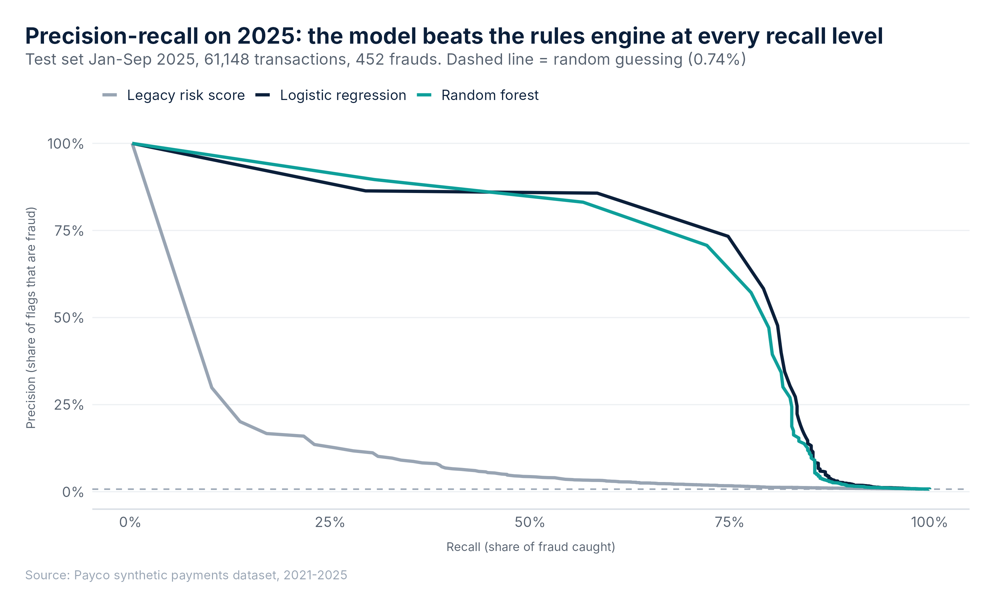
</div>
<table align="center">
  <tr>
    <td width="460" valign="top">
      <ol>
        <li>
          <strong>The Fraud Model Beats the Rules Engine by a Wide Margin</strong>
          <ul>
            <li>PR-AUC of <strong>0.71</strong> against <strong>0.10</strong> for the legacy risk score, on months the model never saw.</li>
            <li>Reviewing just <strong>1% of transactions</strong> catches <strong>78% of fraud</strong>. With the legacy score, the same review effort catches 21%.</li>
            <li>At the chosen threshold, fraud costs fall from <strong>€55K to €10K</strong> in nine months, a saving of <strong>€46K (83%)</strong>.</li>
          </ul>
        </li>
        <li>
          <strong>Fraud Is Not Stable Over Time</strong>
          <ul>
            <li>An account takeover wave in the second half of 2022 pushed the monthly fraud rate to <strong>2.6%</strong>, almost five times the 2021 level.</li>
            <li>By 2025 fraud had moved to new payment methods. BNPL had the highest fraud rate (<strong>1.46%</strong>), almost double the card rate (0.80%).</li>
          </ul>
        </li>
      </ol>
    </td>
    <td width="460" valign="top">
      <ol start="3">
        <li>
          <strong>Payment Failures Are Partly Predictable</strong>
          <ul>
            <li>One attempt in eight fails. The riskiest 10% of attempts fail <strong>31%</strong> of the time, against <strong>2%</strong> for the safest 10% (ROC-AUC 0.71).</li>
            <li>The March 2023 outage at psp_beta caused errors on <strong>56%</strong> of its attempts at the peak.</li>
          </ul>
        </li>
        <li>
          <strong>Churn Can Be Spotted Early</strong>
          <ul>
            <li>42% of active buyers make no purchase in the next 180 days. The churn model ranks buyers well: <strong>82%</strong> of the top-risk decile churn, against 14% of the lowest (ROC-AUC 0.75).</li>
          </ul>
        </li>
        <li>
          <strong>Key Takeaway</strong>
          <ul>
            <li>A simple logistic regression did as well as a random forest. The gain came from <strong>features built without look-ahead</strong>, not from a more complex algorithm.</li>
          </ul>
        </li>
      </ol>
    </td>
  </tr>
</table>

<h2 align="center">Dataset Structure and ERD (Entity Relationship Diagram)</h2>
The database has <strong>17 tables</strong> with about <strong>1.8 million rows</strong> in total. <code>payment_attempts</code> (356,027 rows) is the central fact table. Each checkout in <code>transactions</code> can have several attempts, for example a declined card followed by a successful wallet payment. Labels for the three models come from <code>fraud_labels</code>, the attempt <code>status</code>, and future activity in <code>transactions</code>.
<div align="center">
  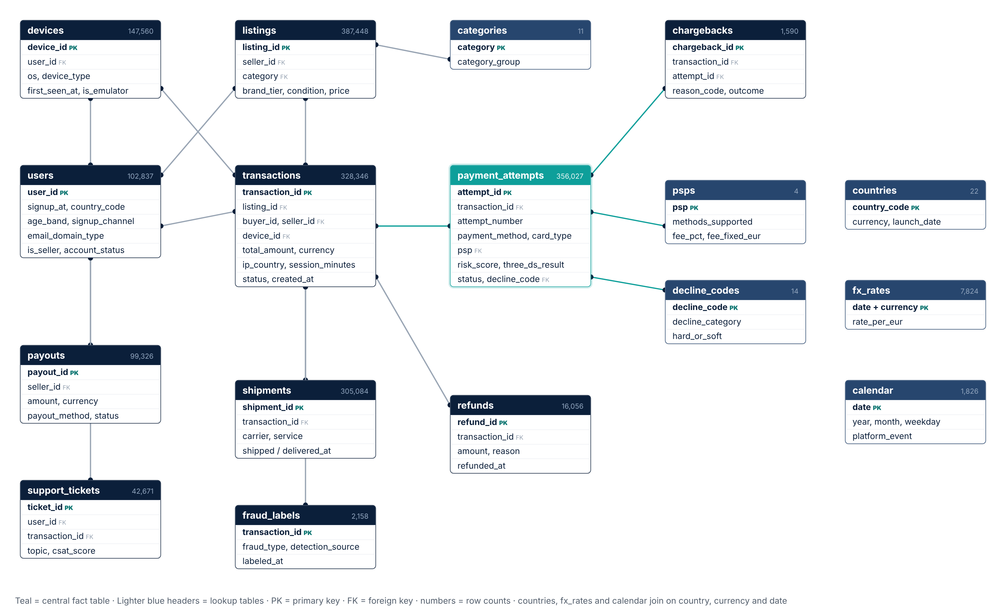
</div>

<h1 align="center">Insights Deep-Dive</h1>

<h1 align="center">Payments Overview</h1>
<div align="center">
  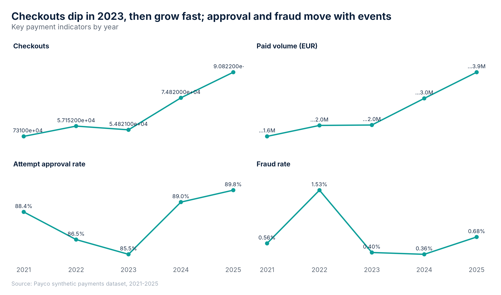
</div>
<table>
  <tr>
    <td>
      <strong>Volume and Approval</strong>
      <ol>
        <li>Paid volume grew from <strong>€1.6M in 2021 to €3.9M in 2025</strong>. Checkouts dipped 4% in 2023, then grew 36% in 2024 and 21% in 2025.</li>
        <li>The attempt approval rate fell from 88.4% in 2021 to <strong>85.5% in 2023</strong>, after the platform made 3-D Secure checks much stricter in response to the fraud wave. It recovered to <strong>89.8% in 2025</strong> once smart retry routing was added.</li>
      </ol>
      <strong>Fraud and Chargebacks</strong>
      <ol>
        <li>The fraud rate was 0.56% in 2021, <strong>1.53% in 2022</strong>, 0.40% in 2023, 0.36% in 2024 and 0.68% in 2025.</li>
        <li>Chargebacks followed the same pattern and peaked at <strong>1.0% of paid transactions in 2022</strong>. Confirmed fraud cost €74K that year, against €23K in 2021.</li>
      </ol>
    </td>
  </tr>
</table>
<table align="center">
  <tr align="center">
    <td width="1000">
      <h3>Payment Method Mix</h3>
      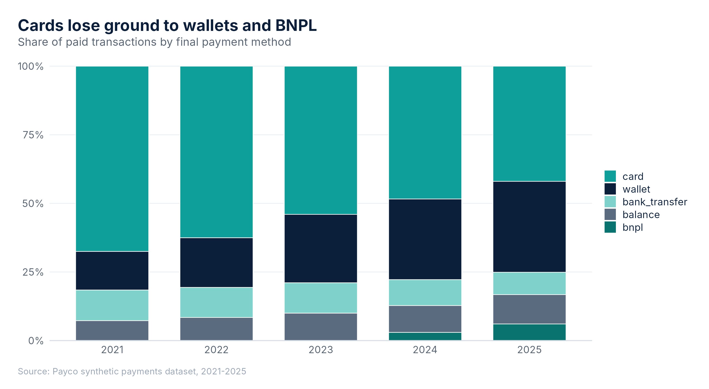
    </td>
    <td width="1000">
      <h3>The Three Modelling Targets</h3>
      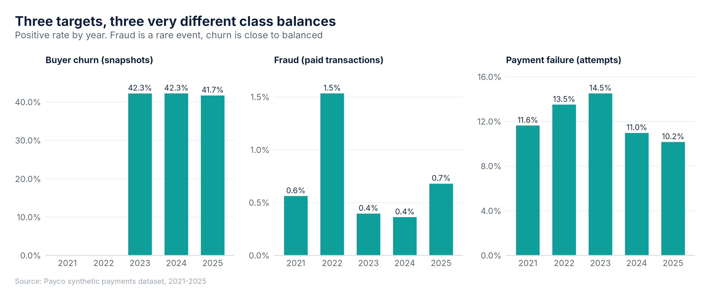
    </td>
  </tr>
</table>
<table>
  <tr>
    <td>
      <ul>
        <li>Cards fell from <strong>68% to 42%</strong> of paid transactions. Wallets grew from 14% to 33%, and BNPL reached 6% within two years of launch.</li>
        <li>The three targets have very different class balances: fraud is <strong>0.69%</strong> (about 1 in 145), payment failure <strong>11.9%</strong> and churn <strong>42%</strong>. That is why I used PR-AUC as the main metric for fraud, since accuracy would be 99.3% for a model that never flags anything.</li>
      </ul>
    </td>
  </tr>
</table>

<h1 align="center">Fraud Patterns</h1>
<div align="center">
  <h3>The Fraud Rate Moves With Attacks, and Recent Labels Are Incomplete</h3>
  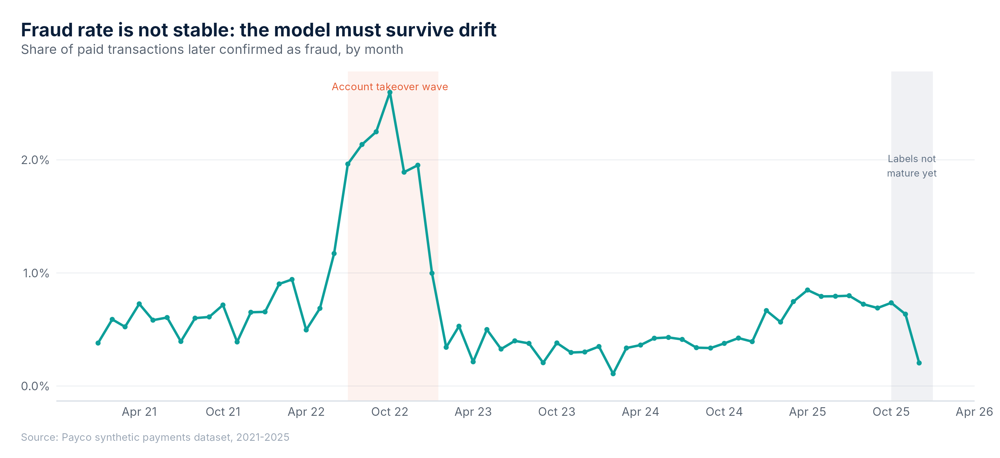
</div>
<table align="center">
  <tr>
    <td width="333" valign="top">
      <h3>Accounts and Devices</h3>
      <ul>
        <li>Accounts less than a week old have a fraud rate of <strong>3.3%</strong>, seven times the rate for accounts older than a year (0.46%).</li>
        <li>A device used by another account earlier is the strongest ring signal: <strong>61% fraud</strong>, against 0.61% on a buyer's own device.</li>
        <li>Checkouts from an IP address outside the buyer's country are fraud <strong>5.7%</strong> of the time.</li>
      </ul>
    </td>
    <td width="333" valign="top">
      <h3>Payment Methods</h3>
      <ul>
        <li>In 2022 the account takeover wave hit cards (1.76%) and balance payments (2.86%), as attackers spent the victims' stored balance.</li>
        <li>In 2025 BNPL had the highest fraud rate (<strong>1.46%</strong>). Wallets stayed the safest method at 0.36%.</li>
      </ul>
    </td>
    <td width="333" valign="top">
      <h3>Label Maturity</h3>
      <ul>
        <li>Fraud is usually confirmed weeks after the payment, through chargebacks, user reports or reviews.</li>
        <li>The apparent drop at the end of 2025 is missing labels, not less fraud. I left <strong>October–December 2025</strong> out of the evaluation.</li>
      </ul>
    </td>
  </tr>
</table>
<table align="center">
  <tr align="center">
    <td width="1000" valign="top">
      <h3>Fraud Rate by Risk Signal</h3>
      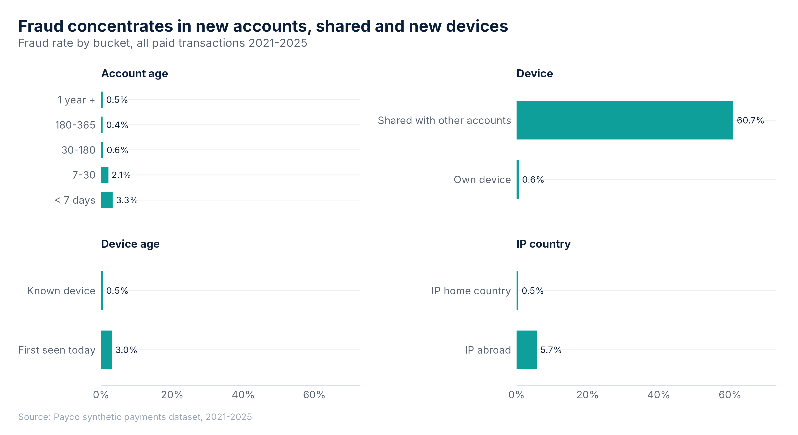
    </td>
    <td width="1000" valign="top">
      <h3>Fraud Rate by Method and Year</h3>
      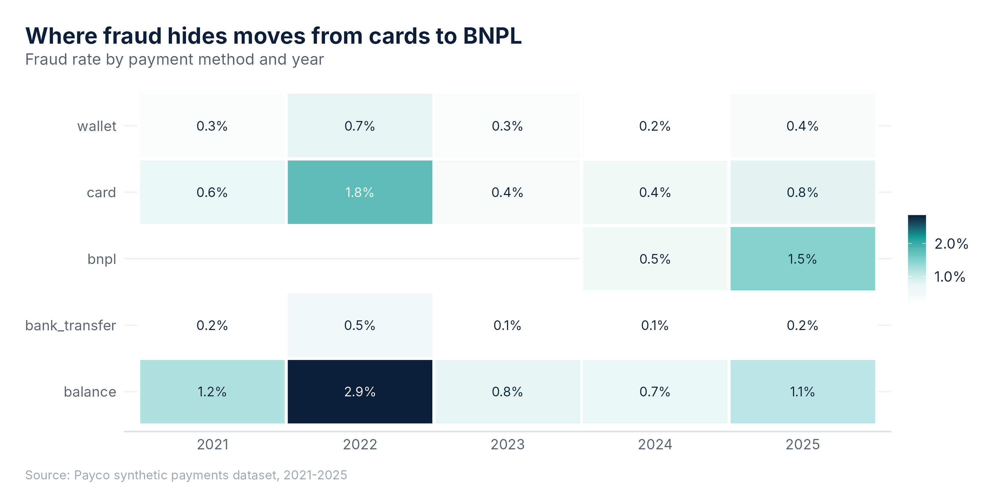
    </td>
  </tr>
</table>

<h1 align="center">Fraud Model</h1>
<table align="center">
  <tr align="center">
    <td width="1000">
      <h3>What the Model Relies On</h3>
      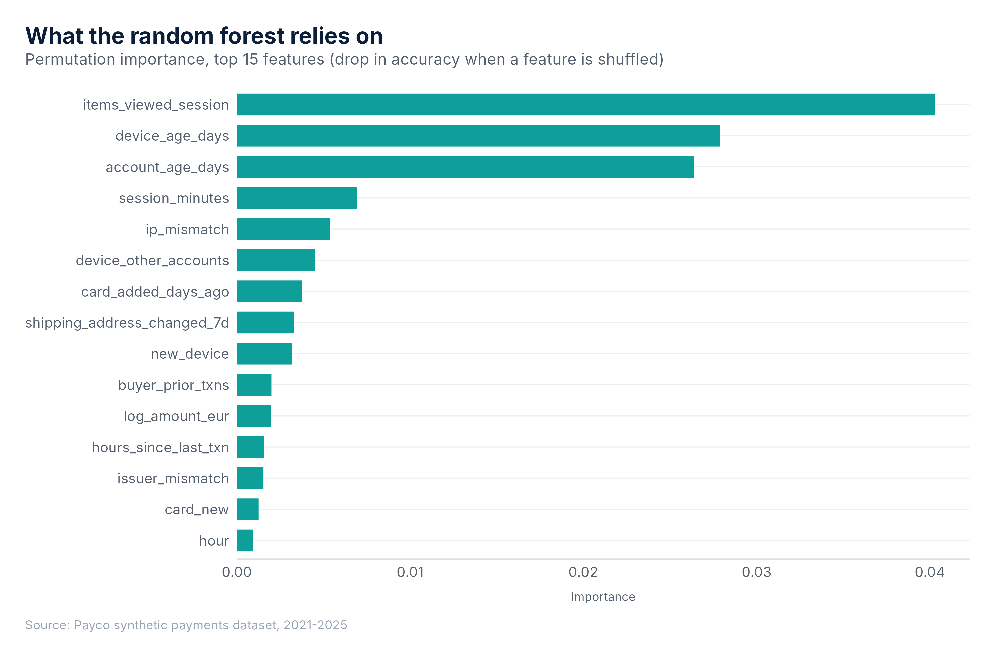
    </td>
    <td width="1000">
      <h3>Choosing the Review Threshold by Cost</h3>
      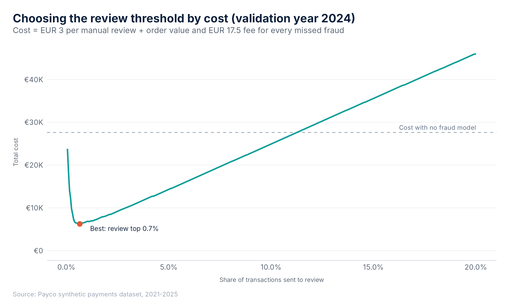
    </td>
  </tr>
</table>
<table>
  <tr>
    <td valign="top" width="500">
      <strong>Approach</strong>
      <ul>
        <li><strong>Time split:</strong> trained on 2021–2024 (225K transactions, 1,565 frauds) and tested on January–September 2025 (61K transactions, 452 frauds).</li>
        <li><strong>Benchmark:</strong> the legacy rules-engine risk score already stored with each payment.</li>
        <li><strong>Models:</strong> logistic regression on all rows, and a random forest (<code>ranger</code>) on all frauds plus ten legitimate transactions per fraud.</li>
        <li><strong>No look-ahead:</strong> every feature is built only from data available at checkout. For example, "other accounts on this device" counts only accounts seen before the transaction.</li>
      </ul>
    </td>
    <td valign="top" width="500">
      <strong>Results</strong>
      <ul>
        <li>Logistic regression: PR-AUC <strong>0.71</strong>, ROC-AUC 0.93. Random forest: PR-AUC 0.70, ROC-AUC 0.92. Legacy score: PR-AUC 0.10, ROC-AUC 0.79.</li>
        <li>The most important features are items viewed in the session, device age and account age. Fraudsters go straight to checkout, often from a new device on a new account.</li>
        <li>The threshold was chosen on 2024 data (€3 per manual review, order value plus €17.50 per missed fraud), then applied unchanged to 2025. It flagged 612 transactions: <strong>351 were fraud</strong> and 101 frauds were missed.</li>
        <li>Performance held every month of 2025, with PR-AUC between 0.66 and 0.79.</li>
      </ul>
    </td>
  </tr>
</table>
<div align="center">
  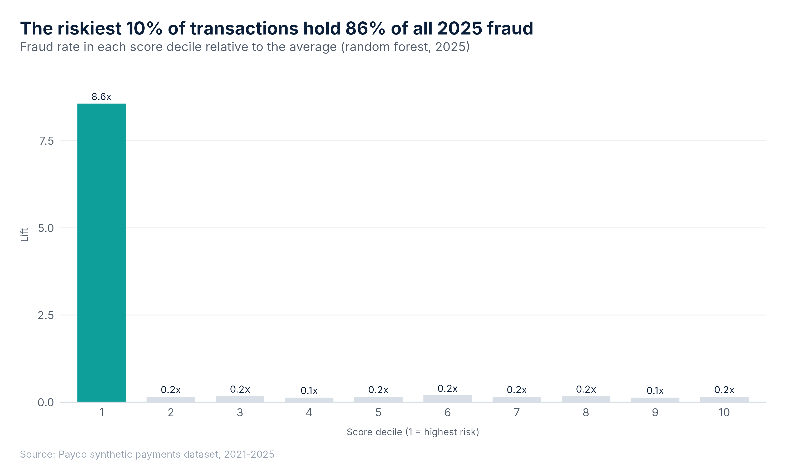
</div>

<h1 align="center">Payment Failure</h1>
<table align="center">
  <tr align="center">
    <td width="1000">
      <h3>Failure Rate by Payment Method</h3>
      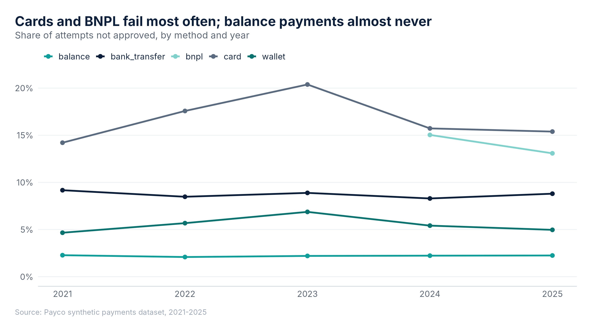
    </td>
    <td width="1000">
      <h3>Decline Reasons</h3>
      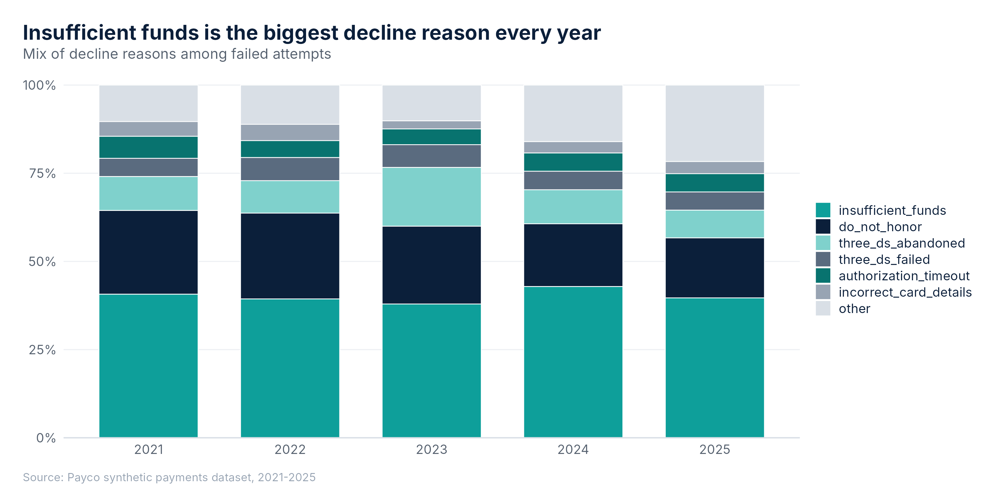
    </td>
  </tr>
</table>
<table>
  <tr>
    <td valign="top" width="500">
      <ul>
        <li>Card attempts fail most: <strong>20.4% in 2023</strong> and 15.4% in 2025. Wallets fail 5.0% of the time and balance payments 2.2%.</li>
        <li><strong>Insufficient funds</strong> is the top decline reason every year (38–43% of failures). These declines are <strong>1.6 times as common</strong> from the 22nd of the month, before payday.</li>
        <li>3DS abandonment almost doubled its share of failures in 2023, when step-up authentication was enforced.</li>
      </ul>
    </td>
    <td valign="top" width="500">
      <ul>
        <li>On 15 March 2023 psp_beta returned errors on <strong>56%</strong> of attempts. The failure model uses each PSP's error rate over the previous hour, so it can react to an outage while it is happening.</li>
        <li>Model (trained on 2021–2024, tested on 2025): ROC-AUC <strong>0.71</strong>, PR-AUC 0.30, against a base rate of 10.2%. The strongest features are card age, card type, account age and the previous decline on the same checkout.</li>
        <li>Most of the decision sits with the card issuer and is not visible to the marketplace. That puts a ceiling on how predictable failure is.</li>
      </ul>
    </td>
  </tr>
</table>
<table align="center">
  <tr align="center">
    <td width="1000">
      <h3>PSP Outage, March 2023</h3>
      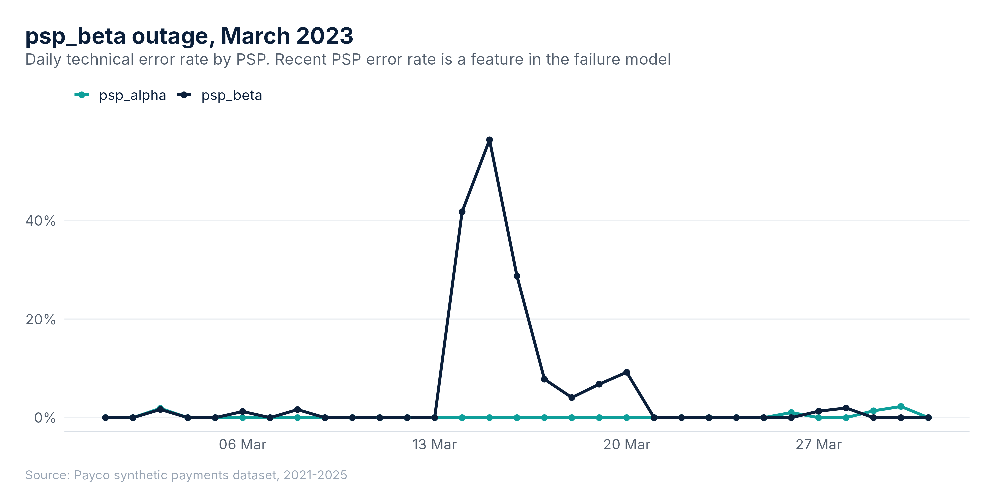
    </td>
    <td width="1000">
      <h3>Actual Failure Rate by Predicted Decile</h3>
      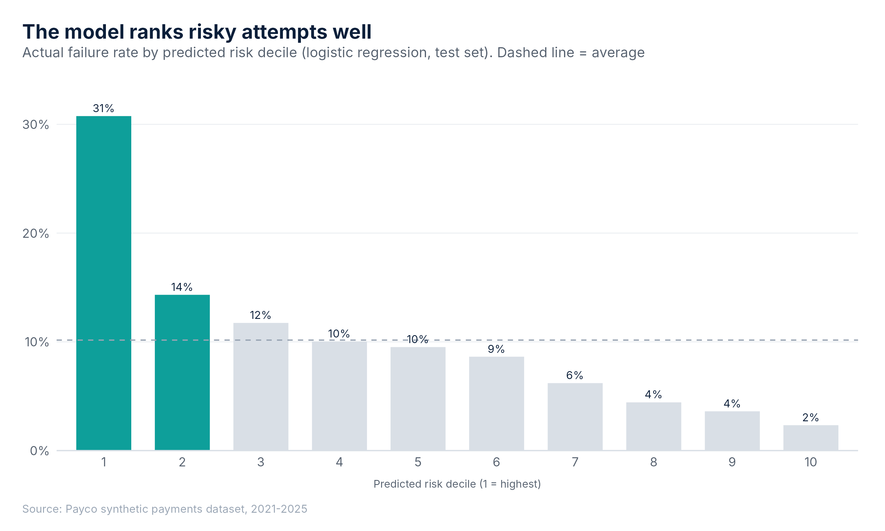
    </td>
  </tr>
</table>

<h1 align="center">Buyer Churn</h1>
<table align="center">
  <tr>
    <td width="500">
      <div align="center">
        <h3>Who Churns</h3>
        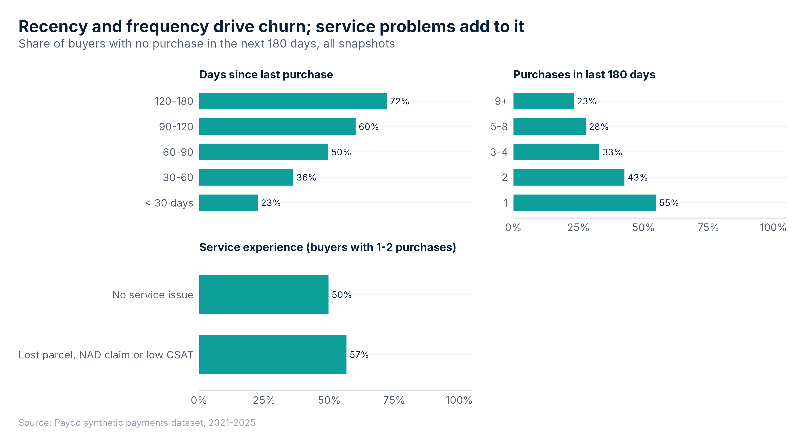
      </div>
    </td>
    <td valign="top" width="500">
      <ul>
        <li><strong>Definition:</strong> a buyer active in the last 180 days who makes no purchase in the next 180 days. I took snapshots every six months, trained on mid-2023 to end-2024 (44K rows) and tested on buyers active on 30 June 2025 (14K).</li>
        <li>Buyers who last bought <strong>120–180 days ago churn 72%</strong> of the time. Those who bought in the last month churn 23%.</li>
        <li>Among buyers with 1–2 purchases, a lost parcel, a not-as-described claim or a low CSAT score raises churn from <strong>50% to 57%</strong>.</li>
        <li>Model: ROC-AUC <strong>0.75</strong>. The top drivers are recency, purchases in the last 60 days, tenure and a falling activity trend.</li>
      </ul>
    </td>
  </tr>
</table>
<table align="center">
  <tr align="center">
    <td width="1000">
      <h3>Churn Drivers</h3>
      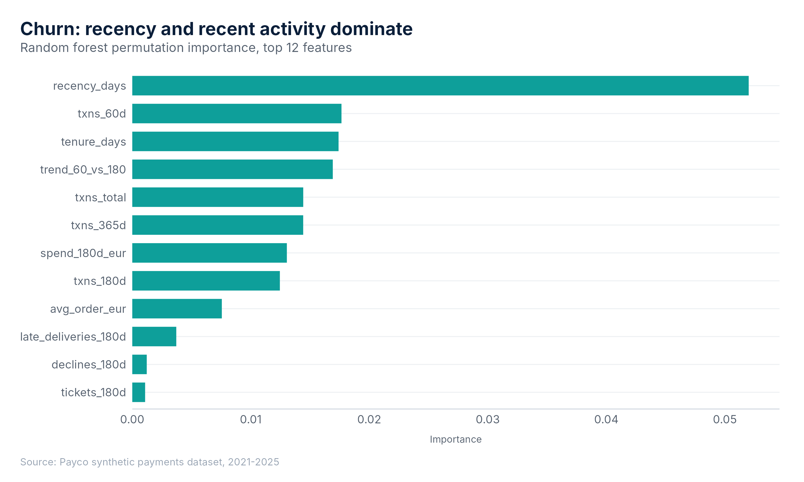
    </td>
    <td width="1000">
      <h3>Actual Churn by Predicted Decile</h3>
      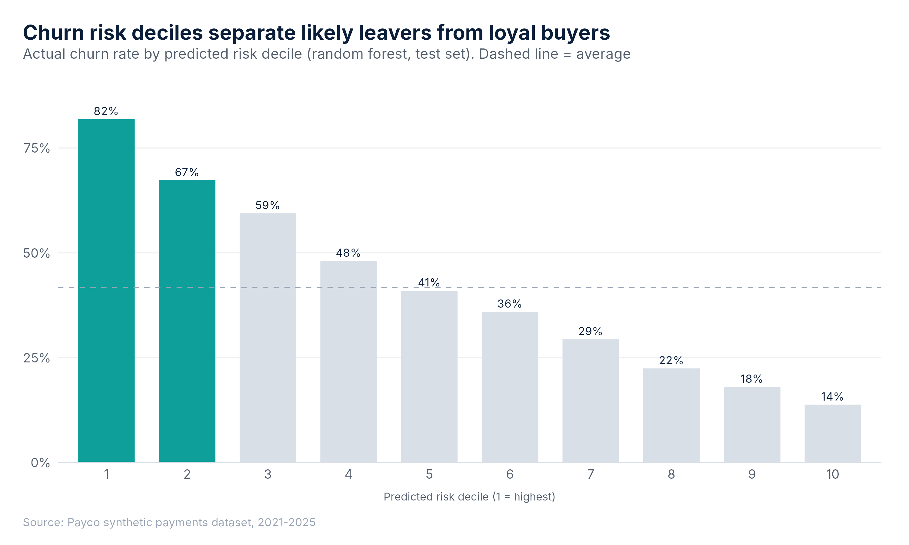
    </td>
  </tr>
</table>

<h1>What I Learned</h1>
<ul>
  <li><strong>Pick the metric for the problem.</strong> With 0.7% fraud, every model has an ROC-AUC above 0.78, including the weak legacy score. PR-AUC and recall at a fixed review rate show the real gap (0.10 vs 0.71).</li>
  <li><strong>Split by time, never randomly.</strong> Fraud patterns change from year to year, so a random split would mix 2025 behaviour into training and overstate performance.</li>
  <li><strong>Labels arrive late.</strong> Recent months look cleaner than they are, because chargebacks and reviews take weeks. Evaluating on them would reward a model for missing fraud.</li>
  <li><strong>Leakage hides in "obvious" columns.</strong> Account status (banned), refunds, chargebacks and device counts computed over the full dataset all leak the answer. I left the first three out and built device counts only from earlier transactions.</li>
  <li><strong>Features beat algorithms.</strong> Logistic regression matched the random forest on all three tasks. It is also easier to explain to a risk team.</li>
  <li><strong>Watch for Simpson's paradox.</strong> In the raw data, buyers who had a failed checkout seem to churn <em>less</em> (33% vs 43%), because frequent buyers have more chances to hit a problem. Experience effects only show up when you compare buyers with similar activity.</li>
  <li><strong>Turn scores into decisions.</strong> A threshold chosen by cost on a separate year gives a review queue the business can actually staff, plus a euro figure for the saving.</li>
</ul>

<h1>Recommendations</h1>
<h4>Based on these results, here are actions the Payments Risk team can take.</h4>
<ul>
  <h3>Fraud</h3>
  <li>Replace the legacy risk score with the logistic regression model and send the top 1% of transactions to manual review.
    <ul>
      <li>It catches 78% of fraud, against 21% for the legacy score at the same workload, and saved an estimated €46K in nine months.</li>
    </ul>
  </li>
  <li>Add hard rules for device sharing and very new accounts on BNPL.
    <ul>
      <li>Devices previously used by other accounts are fraud 61% of the time, and BNPL had the highest fraud rate in 2025 (1.46%).</li>
    </ul>
  </li>
  <li>Monitor the model monthly and retrain at least once a year.
    <ul>
      <li>The fraud rate nearly tripled between 2021 and 2022, and the payment methods that fraudsters target change from year to year.</li>
    </ul>
  </li>
  <h3>Payments</h3>
  <li>Use the failure score to offer a wallet before a risky card payment is attempted.
    <ul>
      <li>Wallets fail 5% of the time against 15% for cards, and the riskiest decile of attempts fails 31% of the time.</li>
    </ul>
  </li>
  <li>Alert on PSP error rates in real time and keep smart retry routing on.
    <ul>
      <li>The 2023 outage pushed one PSP's error rate to 56%. Approval recovered to 89.8% after smart retry routing launched in 2024.</li>
    </ul>
  </li>
  <h3>Retention</h3>
  <li>Target win-back offers at the top two churn-risk deciles.
    <ul>
      <li>82% of the top decile churn within 180 days, and recency is the strongest single signal.</li>
    </ul>
  </li>
  <li>Follow up quickly on lost parcels and not-as-described claims.
    <ul>
      <li>For buyers with 1–2 purchases, these problems raise churn by about 7 percentage points.</li>
    </ul>
  </li>
</ul>

<h1>Technical Details</h1>

<h3>Pipeline</h3>

| Step | Script | What it does |
|---|---|---|
| 0 | `00_theme.R`, `00_model_utils.R` | Chart style (teal, navy and white), metrics for imbalanced targets (PR-AUC, recall at top k), lift tables |
| 1 | `01_load.R` | Imports the 17 CSVs, checks primary and foreign keys |
| 2 | `02_clean.R` | Fixes 14 data quality issues (duplicates, mixed date formats, comma decimals, bad totals, clock skew…), fills weekend FX rates, converts amounts to EUR, logs 25 cleaning rules |
| 3 | `03_features.R` | Builds three modelling tables without look-ahead: fraud (313K paid transactions), failure (355K attempts), churn (59K buyer snapshots) |
| 4 | `04_explore.R` | EDA for modelling: class balance, drift, population stability index, single-feature AUC, failure and churn patterns |
| 5 | `05_model_fraud.R` | Legacy score vs logistic regression vs random forest, cost-based threshold, lift, monthly stability, importance |
| 6 | `06_model_failure_churn.R` | Payment failure and buyer churn models, same evaluation approach |
| 7 | `07_dashboard.Rmd` | Five-page HTML dashboard with KPI cards and a written result under every chart |
| 8 | `08_run_all.R` | Runs the whole pipeline in order, with timing and error handling |

<h3>Dashboard</h3>

`07_dashboard.html` is a static HTML file (no Shiny, no server). A navigation menu switches between five pages: Payments overview, Fraud patterns, Fraud model, Payment failure and Buyer churn.

<div align="center">
  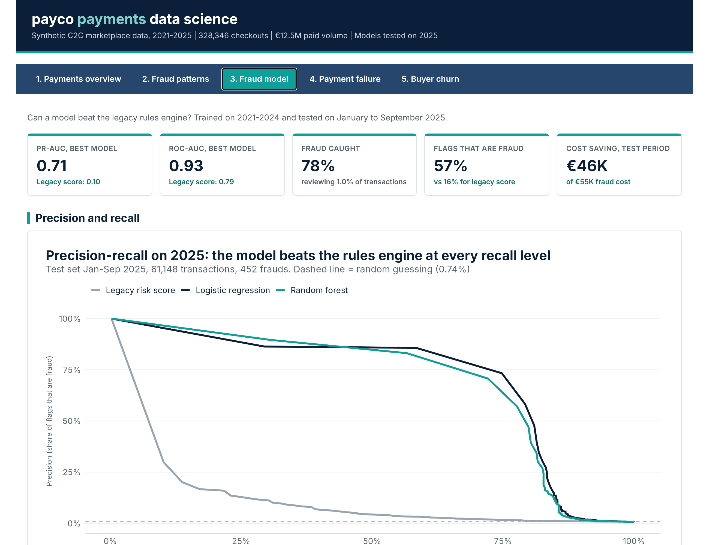
</div>

<h3>How to run</h3>

1. Clone the repository and open the `Payco` folder in RStudio.
2. Check that the working directory is the project folder (Session > Set Working Directory > To Project Directory).
3. Run `source("R/08_run_all.R")`. It takes about five minutes.
4. Open `07_dashboard.html` in a browser.

Missing packages are installed automatically. Requirements: R 4.1 or later, with `readr`, `dplyr`, `tidyr`, `purrr`, `tibble`, `lubridate`, `stringr`, `forcats`, `ggplot2`, `scales`, `ranger`, `ragg`, `htmltools`, `rmarkdown` and `knitr`.

<h3>Project structure</h3>

```
Payco/
├── Data/                 # 17 raw CSV tables
├── R/                    # 00_theme.R … 08_run_all.R
├── Output/               # generated by the pipeline (not tracked)
├── images/               # charts, ERD and screenshots used in this README
├── data_generation/      # Python script that generated the synthetic data
├── 07_dashboard.html
└── README.md
```

---

<h3>Data Availability</h3>

Due to GitHub's file size limits, the four largest tables are not included in this repository:

| File | Size |
|---|---|
| `transactions.csv` | 48 MB |
| `payment_attempts.csv` | 41 MB |
| `listings.csv` | 32 MB |
| `shipments.csv` | 30 MB |

All remaining tables are in the `Data/` folder. The full dataset is available upon request. Feel free to reach out via [LinkedIn](https://www.linkedin.com/in/algirdas-vailionis) or [email](mailto:algirdas.vailionis@gmail.com).

<h3>Author</h3>

<strong>Algirdas Vailionis</strong>, Data Scientist · <a href="https://www.linkedin.com/in/algirdas-vailionis">LinkedIn</a> · <a href="mailto:algirdas.vailionis@gmail.com">Email</a>

---

> **Data disclaimer:** All data in this project is synthetic and was generated for portfolio and learning purposes. Company names, customers, transactions and results are simulated and do not represent any real organisation or individuals.

---
